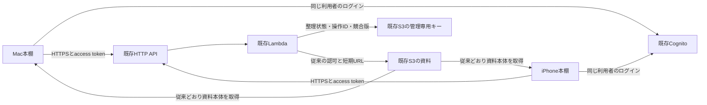

# Mac・iPhone整理同期：AWS構成と料金案（未適用）

2026-10-17。**設計・見積もりのみ**。AWS SDK/CLI、課金照会、実リソースの作成/変更/削除、本番APIへの書込、実データ送信は行っていない。単価は認証不要のAWS公開価格表から当日取得。実構成の把握はリポジトリの[デプロイ記録](phase11b2-deployment.md)、[本人認証の完了記録](phase11b3-validation.md)、現在のAPIコードに基づく。今回ライブ環境を再監査したものではない。

## 推奨構成

東京ap-northeast-1の既存Cognito User Pool、HTTP API、Node.js22 Lambda（256 MB/20秒/VPCなし）、非公開S3を再利用する。初期はDB・WebSocket・常駐サーバーを増やさない。新規AWSリソースはMac用Cognito public app clientだけを基本とし、API/Lambda/IAM/スコープとS3の新しい管理キーを追加する。

資料本体は引き続きS3から読み込む。同期対象はフォルダ/親子/順序、資料IDの所属、グループ/タグ、まとめの順序付き参照だけ。資料の版・タイトルなど未取得資料を表示する最小スナップショットは管理情報に含めるが、PDF/PNG/PPTX、原資料、キャッシュ、ローカルパス/bookmark、フォルダ画像、認証情報、端末ごとの非表示を同期しない。[管理バックアップ](organization-sync-recovery.md)もローカル管理JSONだけで、S3へ送らない。

Macの現在のローカル資料読込は残す。ただし実用接続にはMac側にも既存クラウドAPIの一覧/詳細/短期URLによる取得を追加する必要がある。ローカルにしかない未公開資料は整理参照だけが届いてもiPhoneで本体を開けない。既存の不変資料IDで照合し、名前で同一視したり、自動で資料をアップロードしたりしない。

## 既存認証と認可

- 同じ既存User Pool/owner subを使い、iPhoneの利用者を作り直さない。現行のreadスコープは維持し、新しく`diagram-library/organization.sync`を追加する。同期を有効化した端末だけ再ログインで追加スコープを取得する。readだけの旧トークンは閲覧可能のまま、同期は403。
- iOS public clientはID/callbackを維持して許可スコープだけ追加。Macにはsecretなし・Authorization Code+PKCE S256のpublic clientと完全一致の専用callback（案`zukanbookshelf://oauth/callback`）を追加。同じ利用者なので端末が2台でも新しい利用者数にはしない。ユーザーパスワードをMacへ埋め込まない。[Cognitoの認可エンドポイント](https://docs.aws.amazon.com/cognito/latest/developerguide/authorization-endpoint.html)。
- 現行JWT検証はclient_idを1件だけ許可するため、明示的なiOS/Mac client IDの許可リストへ変更する。署名/JWKS/issuer/access token種別/期限/必要scope/owner subを毎回検査し、任意の同一Pool clientを受け入れない。トークンは各端末Keychain、管理領域はissuer+subで分離。ログアウトや別アカウントへの切替で送信しない。
- 同期ライブラリUUIDはサーバー側の固定設定として1利用者に1件だけ割り当てる。端末が作った任意UUID/subject/S3キーでアクセス先を選べない。認証済みbootstrapでUUIDを返し、requestのlibraryIDと照合する。今のテスト画面の任意URL/任意UUID入力を実用画面へ持ち込まない。現行loopback transportを緩めず、実用版は設定済みHTTPS APIホストだけを許可する別transportとチェックポイント検証を用意し、リダイレクト先へBearerを送らない。
- S3キー案は`library/organization/v1/<SHA256(issuer + sub)>/state.json`。既存`library/state/`のゴミ箱領域やcatalog/成果物と分離。Lambdaにこの新しい管理キーのGetObject/PutObjectだけを追加する。List/Delete/資料Putは増やさない。BPA/SSE-S3/TLS/短期URL、既存権限を維持する。

## API・同時更新・再送

`GET /v1/organization/bootstrap`で利用可能性/固定libraryID/プロトコル版/上限を取得し、`POST /v1/organization/sync`で初回取得または操作バッチを送る。既存`ANY /v1/{proxy+}`配下に分岐を追加できる。readルートの8 KiB本文制限を全体で緩めず、新ルートだけ256 KiB/最大50操作、応答全体2 MiB以下、状態snapshot1 MiB以下を案とする。大きいまとめも同じ要求サイズ検査に従い、クライアントは件数とエンコード後バイト数の両方で分割する。

保存オブジェクトは状態/revision/tombstone/操作IDとpayloadの照合情報/receiptsを**1個のJSON**に入れる。ログだけを先に保存したり、状態とreceiptsを別PUTで確定したりしない。S3のETagは排他用の不透明な版として使い、本文ハッシュや認可として扱わない。

1. JWT/owner/scope/固定libraryID/入力を検証する。未認可要求はS3へアクセスさせない。管理キーがない場合は503で停止する。初期の空オブジェクトは承認済み配備工程で`If-None-Match: *`を使って一度だけ作り、稼働中の消失を空ライブラリとして自動初期化しない。
2. GetObjectでJSONとETagを読む。各キーのexpectedRevisionで統合を判定。同キーの同時変更は競合として返し、別キーの編集は統合する。操作IDとpayloadが既にある場合は保存済みreceiptを返し、内容の異なるID再利用は拒否する。
3. 状態とreceiptを合わせた新JSONを`PutObject If-Match: <ETag>`/AES256で保存する。書込不要ならPUTしない。[S3の条件付き書込](https://docs.aws.amazon.com/AmazonS3/latest/userguide/conditional-writes.html)。
4. 412/409なら再読込して**同じ操作ID**で判定し直す（最大3回、jitter付）。Lambda内メモリーのロックに頼らない。上限後は一時失敗を返して端末の送信待ちを残す。
5. 保存後に応答を失っても、再送は同じreceiptで完了する。結果不明の操作のID/payloadを途中で置き換えず、後続編集は前の結果確定後の操作として扱う。現ローカルエンジンの再送中追加編集もこの契約に照合してから本番化する。

親削除時の子/所属解除も一つのJSON更新内で確定する。receiptとtombstoneは初期は削除しない。保存JSONは16 MiBを上限案とし、80%で管理通知、上限で新規書込を停止して送信待ちを維持する。履歴を黙って捨てて古い端末から復活させない。保存容量/CPU/応答サイズの実測が上限へ近づく場合はDynamoDB等への移行と料金を別に設計する。寿命を短くしたreceipt清掃は今回の初期案に含めない。

既存APIはTypeScript、同期authorityの検証実装はSwiftなので、**Swift実装をそのまま既存Lambdaへ配置できるわけではない**。初期はTypeScriptへ同じ意味論を実装し、共通JSON契約/ゴールデンfixtureでSwiftとの同等性を検証する。API認証/S3アクセス/配備を再利用し、合流・重複排除・削除処理の検証を省かない。

## 起動・利用・復元

初期の実用版は起動/復帰/手動同期を基本にする。編集後は短いデバウンスでまとめ、フォアグラウンド中だけ送る。同時要求は1本、offline/429/5xxは指数バックオフとjitter。無変更でも数秒おきに全状態を読むタイマー、WebSocket、APNs、バックグラウンド常駐は初期導入しない。したがって両端末を開いたまま別端末で編集したときの即時反映は保証せず、復帰/手動更新で取得する。

端末ごとに初回管理バックアップ→統合件数と競合の確認→少量で同期を有効化。ローカル復元はその端末を停止して戻すだけで、クラウドやもう一台を巻き戻さない。復元後は送信待ちを解除し、再参加時に初回統合を再確認する。アカウント違い/libraryID違い/読取失敗/保存消失なら自動統合を停止する。

## 料金シミュレーション

最新の[東京単価・SKU・公開日](organization-sync-aws-rates.json)、[計算結果](organization-sync-aws-estimate.json)、再計算`python3 scripts/estimate-organization-sync.py`。認証不要の公開価格表を使い、AWSアカウント/Cost Explorerは呼ばない。為替は実勢ではなく比較用に1 USD=160円、税係数1.10（176円/USD）。API/Lambda/ログの無料枠・クレジットは最初から控除しない。転送枠だけ余裕あり/なしを並べる。実測した使用量や請求上限ではない。

|項目|東京の単価（USD）|公式根拠|
|---|---:|---|
|HTTP API|1.29/100万要求|[地域価格表](https://pricing.us-east-1.amazonaws.com/offers/v1.0/aws/AmazonApiGateway/current/ap-northeast-1/index.json)|
|Lambda x86要求/計算|0.20/100万要求、0.0000166667/GB秒|[地域価格表](https://pricing.us-east-1.amazonaws.com/offers/v1.0/aws/AWSLambda/current/ap-northeast-1/index.json)|
|S3 Standard/PUT/GET|0.025/GB月、0.0047/千PUT、0.00037/千GET|[地域価格表](https://pricing.us-east-1.amazonaws.com/offers/v1.0/aws/AmazonS3/current/ap-northeast-1/index.json)|
|CloudWatch Logs取込/保存|0.76/GB、0.033/GB月|[地域価格表](https://pricing.us-east-1.amazonaws.com/offers/v1.0/aws/AmazonCloudWatch/current/ap-northeast-1/index.json)|
|外向き転送、無料枠超過後の最初の帯域|0.114/GB|[地域価格表](https://pricing.us-east-1.amazonaws.com/offers/v1.0/aws/AWSDataTransfer/current/ap-northeast-1/index.json)|
|Cognito Essentials直接ログイン|無料枠超過分0.015/MAU|[公式料金](https://aws.amazon.com/cognito/pricing/)|

Lambdaは現状のx86相当で試算し、Arm移行の節約は前提にしない。API応答は今回の全状態方式を保守的に毎回転送し、receipt込み平均100/500 KiBとする。本文に署名URLを入れず、ログはpayload/タイトル/tokenを出さず1 KiB/要求、保持14日。S3→同一リージョンLambdaの転送とインターネット入向きは課金対象外、API→端末の転送は1回だけ計上する。[S3転送の条件](https://aws.amazon.com/s3/pricing/)。表のGBは2^30 bytesで計算する。

|月額追加分の条件|通常|多用|
|---|---:|---:|
|利用者/端末|1人/2台|1人/2台|
|同期要求（再送込み）|1,200回＝各端末20回/日×30日|12,000回＝各端末200回/日×30日|
|変更バッチ/追加CAS試行|300/30|6,000/1,200|
|平均実行時間、256 MB|300 ms|1,000 ms|
|平均応答/外向き転送|100 KiB/0.1144 GiB|500 KiB/5.7220 GiB|
|receipt込み管理保存/新コード追加分|5 MiB/1 MiB|16 MiB/1 MiB|
|API/Lambda/S3/ログ、転送枠に余裕|**約1.11円/月**|**約20.40円/月**|
|転送無料枠なしの追加分|**約3.41円/月**|**約135.20円/月**|
|さらに1 MAUの認証費を全額配賦した参考値|**約6.05円/月**|**約137.84円/月**|

Cognitoは同じPoolの既にactiveな本人を使うため、2台目のログインで増えるMAUは0。本人1 MAUが既存費用として既に課金される場合、認証費約2.64円をもう一度「同期追加分」に足さない。最終行は無料枠がなく、本人の認証費までこの機能へ全額配賦する比較用上限寄りケース。[MAU定義](https://aws.amazon.com/cognito/pricing/)。SMS/メールを毎同期で発行しない。初回/パスワード回復等のメールは既存認証の費用で、この定常同期試算には含めない。

通常/転送枠なしの内訳はAPI0.27、Lambda0.31、S3保存とGET/PUT0.38、ログ0.16、転送2.30円。固定の新規サーバー/DB月額は0。1回の空状態初期PUTは約0.00083円、コードデプロイPUT等も小額だが、初回開発/配備の検証・再実行回数は未確定なので定常月額とは別。バケットVersioningを新規に有効化しない案で、旧版の積み上がりを仮定しない（記録上は無効、適用前に読み取り再確認）。

**既存の資料保存・資料転送・catalog読取は別料金のまま**。先行の[約33〜36円/月](phase11b-public-api-plan.md)は2026-10-10時点の「100資料×3版・閲覧200回等」という仮定で、現在の実請求ではない。同じ仮定が続く参考合算なら通常同期を足して約36〜39円/月。今回の同期試算でその既存使用量を実測/再見積もりしたわけではなく、100円以内を保証しない。

多用/無料転送枠なしでは同期だけで100円を超える。主因は全snapshot転送（約115円）。初期は上記の復帰/編集集約/手動方式に抑え、必要なら無変更応答を短く返すバージョン付き契約や差分取得をローカルで追加検証する。仮に応答を平均50 KiBへ縮められれば同じ多用回数の転送は約11.48円となり、追加合計は約31.88円（実測/実装前の感度分析）。上限超過時に安全な履歴を捨てる・認可を省く・資料を削除する対応はしない。

S3の保存JSONを毎回読むため、保存サイズが増えるとLambda時間は増える。300/1,000 msは設計仮定であり、実装後に最大サイズ/同時編集/コールドスタートを測り直す。失敗要求のPUTは課金されない場合も含め保守的に全試行を計上している。既存APIの1 req/s/burst5は維持し、429時に端末が待つ。スロットルや予算通知は課金の厳密な上限ではない。

## 代替と実装順

S3の1オブジェクト方式は、個人2台・小さな整理状態・現モデルの全状態応答に合わせた初期案。DynamoDB on-demandは大規模/複数利用者や履歴分離に向くが、状態とreceiptのtransaction、採番、親削除の分割整合性を別設計する必要がある。今回は低頻度のためDBを増やさず始め、サイズ/競合/処理時間を理由に移行を判断する。専用の別Lambdaは既存閲覧との障害分離が必要になったときの代替で、初期は既存関数を再利用する。

1. **AWS変更なし**：TypeScript authority/CASストアのローカル実装、認証付きHTTPS transportとbootstrap、Swift相互fixture。認可漏れ/操作ID再利用/ACK喪失/同時更新/削除/上限/入力サイズ/restore再参加/未取得資料をテスト。MacのOIDC/クラウド一覧・取得もローカル/モックで接続する。
2. **配備前の確認・承認**：既存実構成をread-onlyで再確認し、この料金を最新条件/実測で更新。CloudFormationの変更セットと新キーへの初期管理JSON、IAM差分、Mac client/callback、scope、feature flag、ロールバック案を提示する。資料の送信承認とは分ける。まだ実行しない。
3. **別途承認後**：既存Poolを置換せずclient/scope追加、既存API/Lambdaへ同期ルートと新管理キー限定権限、管理キーの初期空状態を追加。既存データは初回バックアップ/プレビュー前に送信しない。機能flagで同期だけ無効化して閲覧を維持できるようにする。
4. **少量の実端末確認**：同じ本人でMac/iPhoneへログインし、初回レビュー→1フォルダ/1タグ→双方向→offline再送→競合→ローカル復元を確認してから普段の本棚へ広げる。

今回作成したものは設計/計算ファイルだけ。AWS変更・本番同期・資料アップロード・実機更新を承認済みとは扱わない。
