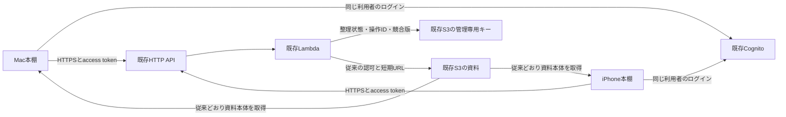

# Mac・iPhone整理同期：AWS構成と料金案（未適用）

2026-10-18再計算（受付・終了・回数台帳・再送・無変更応答の削減込み）。**設計・見積もりのみ**。AWS SDK/CLI、課金照会、実リソースの作成/変更/削除、本番APIへの書込、実データ送信は行っていない。単価は認証不要のAWS公開価格表から当日取得。実構成の把握はリポジトリの[デプロイ記録](phase11b2-deployment.md)、[本人認証の完了記録](phase11b3-validation.md)、現在のAPIコードに基づく。今回ライブ環境を再監査したものではない。

## 推奨構成

東京ap-northeast-1の既存Cognito User Pool、HTTP API、Node.js22 Lambda（256 MB/20秒/VPCなし）、非公開S3を再利用する。初期はDB・WebSocket・常駐サーバーを増やさない。新規AWSリソースはMac用Cognito public app clientだけを基本とし、API/Lambda/IAM/スコープとS3の新しい管理キーを追加する。

資料本体は引き続きS3から読み込む。同期対象はフォルダ/親子/順序、資料IDの所属、グループ/タグ、まとめの順序付き参照だけ。資料の版・タイトルなど未取得資料を表示する最小スナップショットは管理情報に含めるが、PDF/PNG/PPTX、原資料、キャッシュ、ローカルパス/bookmark、フォルダ画像、認証情報、端末ごとの非表示を同期しない。[管理バックアップ](organization-sync-recovery.md)もローカル管理JSONだけで、S3へ送らない。

Macの現在のローカル資料読込は残す。ただし実用接続にはMac側にも既存クラウドAPIの一覧/詳細/短期URLによる取得を追加する必要がある。ローカルにしかない未公開資料は整理参照だけが届いてもiPhoneで本体を開けない。既存の不変資料IDで照合し、名前で同一視したり、自動で資料をアップロードしたりしない。

## 既存認証と認可

- 同じ既存User Pool/owner subを使い、iPhoneの利用者を作り直さない。現行のreadスコープは維持し、新しく`diagram-library/organization.sync`を追加する。同期を有効化した端末だけ再ログインで追加スコープを取得する。readだけの旧トークンは閲覧可能のまま、同期は403。
- iOS public clientはID/callbackを維持して許可スコープだけ追加。Macにはsecretなし・Authorization Code+PKCE S256のpublic clientと完全一致の専用callback（案`zukanbookshelf://oauth/callback`）を追加。同じ利用者なので端末が2台でも新しい利用者数にはしない。ユーザーパスワードをMacへ埋め込まない。[Cognitoの認可エンドポイント](https://docs.aws.amazon.com/cognito/latest/developerguide/authorization-endpoint.html)。
- 現行JWT検証はclient_idを1件だけ許可するため、明示的なiOS/Mac client IDの許可リストへ変更する。署名/JWKS/issuer/access token種別/期限/必要scope/owner subを毎回検査し、任意の同一Pool clientを受け入れない。トークンは各端末Keychain、管理領域はissuer+subで分離。ログアウトや別アカウントへの切替で送信しない。
- 同期ライブラリUUIDはサーバー側の固定設定として1利用者に1件だけ割り当てる。端末が作った任意UUID/subject/S3キーでアクセス先を選べない。認証済みbootstrapでUUIDを返し、requestのlibraryIDと照合する。今のテスト画面の任意URL/任意UUID入力を実用画面へ持ち込まない。現行loopback transportを緩めず、実用版は設定済みHTTPS APIホストだけを許可する別transportとチェックポイント検証を用意し、リダイレクト先へBearerを送らない。
- S3キー案は`library/organization/v1/<SHA256(issuer + 改行 + sub)>/state.json`。既存`library/state/`のゴミ箱領域やcatalog/成果物と分離。Lambdaにこの新しい管理キーのGetObject/PutObjectだけを追加する。List/Delete/資料Putは増やさない。BPA/SSE-S3/TLS/短期URL、既存権限を維持する。

## API・同時更新・再送

`GET /v1/organization/bootstrap`で利用可能性/固定libraryID/プロトコル版/上限を取得し、`POST /v1/organization/sync`で初回取得または操作バッチを送る。既存`ANY /v1/{proxy+}`配下に分岐を追加できる。readルートの8 KiB本文制限を全体で緩めず、新ルートだけ256 KiB/最大50操作、応答全体2 MiB以下、状態snapshot1 MiB以下を案とする。大きいまとめも同じ要求サイズ検査に従い、クライアントは件数とエンコード後バイト数の両方で分割する。

保存オブジェクトは状態/revision/tombstone/操作IDとpayloadの照合情報/receiptsを**1個のJSON**に入れる。ログだけを先に保存したり、状態とreceiptsを別PUTで確定したりしない。S3のETagは排他用の不透明な版として使い、本文ハッシュや認可として扱わない。

1. JWT/owner/scope/固定libraryID/入力を検証する。未認可要求はS3へアクセスさせない。管理キーがない場合は503で停止する。初期の空オブジェクトは承認済み配備工程で`If-None-Match: *`を使って一度だけ作り、稼働中の消失を空ライブラリとして自動初期化しない。
2. GetObjectでJSONとETagを読む。各キーのexpectedRevisionで統合を判定。同キーの同時変更は競合として返し、別キーの編集は統合する。操作IDとpayloadが既にある場合は保存済みreceiptを返し、内容の異なるID再利用は拒否する。
3. 状態とreceiptを合わせた新JSONを`PutObject If-Match: <ETag>`/AES256で保存する。書込不要ならPUTしない。[S3の条件付き書込](https://docs.aws.amazon.com/AmazonS3/latest/userguide/conditional-writes.html)。
4. 412/409なら再読込して**同じ操作ID**で判定し直す（最大3回、jitter付）。Lambda内メモリーのロックに頼らない。上限後は一時失敗を返して端末の送信待ちを残す。
5. 保存後に応答を失っても、再送は同じreceiptで完了する。結果不明の操作のID/payloadを途中で置き換えず、後続編集は前の結果確定後の操作として扱う。現ローカルエンジンの再送中追加編集もこの契約に照合してから本番化する。

親削除時の子/所属解除も一つのJSON更新内で確定する。receiptとtombstoneは初期は削除しない。保存JSONは16 MiBを上限案とし、80%で管理通知、上限で新規書込を停止して送信待ちを維持する。履歴を黙って捨てて古い端末から復活させない。保存容量/CPU/応答サイズの実測が上限へ近づく場合はDynamoDB等への移行と料金を別に設計する。寿命を短くしたreceipt清掃は今回の初期案に含めない。

既存APIはTypeScript、同期authorityの検証実装はSwiftなので、**Swift実装をそのまま既存Lambdaへ配置できるわけではない**。TypeScriptへ同じ意味論を[ローカル実装](organization-sync-api-local.md)し、共通JSON fixture75ステップでSwiftの応答との一致を検証した。既定Lambdaには接続しておらず実AWS上の同等性を保証しない。API認証/S3アクセス/配備を再利用し、合流・重複排除・削除処理の検証を省かない。

## 起動・利用・復元

初期の実用版は起動/復帰/手動同期を基本にする。編集後は短いデバウンスでまとめ、フォアグラウンド中だけ送る。同時要求は1本、offline/429/5xxは指数バックオフとjitter。無変更でも数秒おきに全状態を読むタイマー、WebSocket、APNs、バックグラウンド常駐は初期導入しない。したがって両端末を開いたまま別端末で編集したときの即時反映は保証せず、復帰/手動更新で取得する。

端末ごとに初回管理バックアップ→統合件数と競合の確認→少量で同期を有効化。ローカル復元はその端末を停止して戻すだけで、クラウドやもう一台を巻き戻さない。復元後は送信待ちを解除し、再参加時に初回統合を再確認する。アカウント違い/libraryID違い/読取失敗/保存消失なら自動統合を停止する。

## 同期回数の追加条件（AWS未適用）

本人の指定で、通常は利用者の全端末合計で直近1時間5回、追加は画面同意1回だけとする。[回数仕様](organization-sync-quota.md)をローカルのテスト本棚で実装・確認済み。AWSでは認証済みissuer/subで台帳を固定し、受付/確認challenge/終了を同期ルート内のactionとして処理する。S3の状態と同じCAS保護内で予約/要求予算を永続化し、メモリーだけで数えない。恒久解除は公開しない。

以下は制御往復を含めた再計算。begin/sync/finishを同じ認証済み同期ルートのactionとして扱い、bootstrapは接続/復帰時だけ取得する。5回は論理開始数であり、API請求の5要求ではない。

## 料金シミュレーション

最新の[東京単価・SKU・公開日](organization-sync-aws-rates.json)、[計算結果](organization-sync-aws-estimate.json)、再計算`python3 scripts/estimate-organization-sync.py`。認証不要の公開価格表を使い、AWSアカウント/Cost Explorerは呼ばない。為替は実勢ではなく比較用に1 USD=160円、税係数1.10（176円/USD）。API/Lambda/ログの無料枠・クレジットは最初から控除しない。転送枠だけ余裕あり/なしを並べる。実測した使用量や請求上限ではない。

|項目|東京の単価（USD）|公式根拠|
|---|---:|---|
|HTTP API|1.29/100万要求|[地域価格表](https://pricing.us-east-1.amazonaws.com/offers/v1.0/aws/AmazonApiGateway/current/ap-northeast-1/index.json)|
|Lambda x86要求/計算|0.20/100万要求、0.0000166667/GB秒|[地域価格表](https://pricing.us-east-1.amazonaws.com/offers/v1.0/aws/AWSLambda/current/ap-northeast-1/index.json)|
|S3 Standard/PUT/GET|0.025/GB月、0.0047/千PUT、0.00037/千GET|[地域価格表](https://pricing.us-east-1.amazonaws.com/offers/v1.0/aws/AmazonS3/current/ap-northeast-1/index.json)|
|CloudWatch Logs取込/保存|0.76/GB、0.033/GB月|[地域価格表](https://pricing.us-east-1.amazonaws.com/offers/v1.0/aws/AmazonCloudWatch/current/ap-northeast-1/index.json)|
|外向き転送、無料枠超過後の最初の帯域|0.114/GB|[地域価格表](https://pricing.us-east-1.amazonaws.com/offers/v1.0/aws/AWSDataTransfer/current/ap-northeast-1/index.json)|
|Cognito Essentials直接ログイン|無料枠超過分0.015/MAU|[公式料金](https://aws.amazon.com/cognito/pricing/)|

### 計算条件と数え方

30日・本人1人・Mac/iPhone計2台。通常は合計40同期/日＝1,200回/月、追加なし。5回/時を24時間30日使う比較は**合計3,600回/月**（31日なら3,720回）。追加同意、拒否要求、認証されない要求はこの上限とは別に費用が発生し得る。

1同期につきbegin 1＋データ1＋finish 1の3 HTTP。初回取得→確認後送信は受付10分以内ならデータ2回を同じ1同期内で行う。分割を含むデータ要求は最大12 ID×各3送信。begin/finishも各3送信と仮定すれば42 HTTP/同期になる（全HTTPの厳密上限ではない）。追加同意はchallenge取得を1往復追加する。bootstrapは2台合計60回/月、拒否は通常30回/月・上限利用60回/月を仮定。待ち中のアプリ表示更新は通信なし。

通常ケースは受付/終了の再送240回＋データ再送120回（基本3,600 HTTPの10%）も計上。通常＋追加のケースは通常1,200回＋本人同意300回/月、再送480回。全再送ケースは各HTTPを3回送信し、S3 CASも全書込を3回試行する厳しい仮定。通常の一時障害と常時三重の障害を混同しない。

S3は各制御送信につきGET1＋PUT1（拒否もchallenge保存を保守的に計上）、変更を伴うデータ送信は要求予算の保存と状態/receiptの保存を合わせて**GET2＋PUT2**を計上。[無変更応答](organization-sync-efficiency.md)は予算保存の**GET1＋PUT1**だけにする。この無変更時の2回目の保存省略以外、再送時の冪等短絡などによる節約は見込まない。CAS試行は各PUTに乗算し、対応する再GETも計上。最終AWS実装が原子的な1 PUTに統合できれば減るが、節約は見込まない。台帳と整理状態は同一管理JSONのCAS保護下に置き、台帳更新で整理revisionを増やさない。[条件付き書込の公式仕様](https://docs.aws.amazon.com/AmazonS3/latest/userguide/conditional-writes.html)。

Lambdaは現状のx86/256 MB、平均実行300 ms、全再送/ストレスケース1秒（S3待ち・JWT処理込みの仮定、実測前）。HTTPごとAPI/Lambda各1要求、bootstrapにも計算時間を配賦。ログはAPI＋Lambda合算2 KiB/HTTP、本文/token/資料名は出さず14日保持。保存は管理JSON5/16 MiB＋新コード1 MiB、S3 Versioningを新規有効化しない。旧版が残る場合は別見積もり。管理バックアップはローカルJSONだけ、資料本体を複製しない。

データ応答は変更時に通常100 KiB、上限利用500 KiB、ストレス2 MiB。改善後は通常/上限/再送/追加ケースのデータ要求の75%が無変更と仮定し、無変更応答を1 KiBで予算化する。300フォルダ＋1タグの模擬HTTP実測は25 bytes（full 50,901 bytes以上）だが、実利用の75%比率や本番全状態サイズを測定したわけではない。ストレスケースは無変更0%。制御/bootstrapは2 KiB。再送の応答もすべて課金転送とする保守的な計算。S3→同地域Lambdaや入向き転送は0、外向き応答は1回だけ計上。API要求本文は256 KiB以下の案なので512 KB課金単位を超えない。GB換算は2^30 bytes。無料転送枠は他サービスと共有し、残量を今回照会していない。左列も100 GiBを超えた分は有料として計算する。[無料転送枠の公式説明](https://aws.amazon.com/about-aws/global-infrastructure/global-network/faqs/)。100円判定は右列（転送無料枠なし）を使う。

|月間条件（本人の全端末合計）|HTTP回数|改善前・転送枠なし|改善後・共有100 GiB全量残る|改善後・転送枠なし|
|---|---:|---:|---:|---:|
|通常1,200同期、10%再送を追加|4,050|10.41円|6.89円|**7.65円**|
|毎時5回を30日、再送なし|10,920|55.81円|18.68円|**27.62円**|
|同じ3,600同期、全HTTP3送信＋全CAS3試行|32,760|261.52円|135.67円|**162.50円**|
|通常＋同意した追加300同期、10%再送|5,370|13.53円|9.12円|**10.08円**|
|最大分割/3送信/全CAS3試行、2 MiB、無変更なし|151,560|6,022.14円|4,015.74円|**6,022.14円**|

通信失敗後は即時再送をやめて30秒以上待ち、Retry-Afterを優先する。料金は改善前と**同じ月間HTTP回数・同じLambda時間**を維持して比較した。待機によって月間要求数やCPU時間が減る効果は割り引かない。全HTTP3送信の行は自動三重再送の実装ではなく、時間を置いた明示的な再試行が多い場合の感度分析。サーバーのS3 CAS再試行設計は今回未実装/未変更で、最悪3試行を残す。

最終行はプロトコルの分割/再送予算を使い切る感度分析であり、利用予測でも真の請求上限でもない。最後の応答上限付近ではJSON envelopeも含め2 MiB内に収める設計検証が必要。通常の月には初回統合のデータ1回追加が端末ごとに発生し得るが、通常の再送余裕360 HTTP内に含めて考える（3回目の初期化や無制限の再参加は仮定しない）。

通常/転送枠なしの改善前10.41円→改善後7.65円（約27%減）、毎時5回正常は55.81円→27.62円（約51%減）。無変更応答を小さくし、その際の2回目の状態保存を省く効果だけを反映する。項目別内訳はJSONを正とする。無変更が0%なら改善前の値のままで、失敗待機だけで費用が必ず減るとは見積もらない。

Cognitoは既にactiveな同一ownerを両端末で使うので同期の追加MAUは0。Essentialsの直接ログイン無料枠が使えず、本人1 MAUを全額配賦すると別途2.64円/月。同期ごとのメール/SMS発行やM2M認証は採用しない。[Cognito公式料金とMAU定義](https://aws.amazon.com/cognito/pricing/)。

### 月100円の判定

**無変更75%の仮定なら、通常の同期追加約7.65円、毎時5回の正常通信約27.62円で100円以内の見込み。ただし5回/時と失敗待機だけで100円の上限にはならない。** 再送・CAS競合・分割数・追加同意・拒否要求・全件応答の量で超える。

既存の資料保存/閲覧/認証まで含めるなら、[既存の約33〜36円/月](phase11b-public-api-plan.md)という過去の参考条件（100資料×3版、閲覧200回等）を同じまま置いた比較で、通常合算は約41〜44円、毎時5回の正常通信は約61〜64円。既存の数字は今回の実使用量ではなく、10円の余裕も含む概算。**現在の全体請求が100円内とは断定できない**。資料本体の転送量・版の蓄積・既存API使用量は同期制限では抑えられない。Cognitoをこの参考合算へ重複加算しない。

為替160円/USD・税1.10を仮定。180円/USDなら同期追加は通常約8.60円、毎時5回の正常通信約31.07円。既存側も同じ倍率を掛けた参考全体は約68〜72円。一方、無変更0%の上限正常では以前の約89〜92円（180円なら約100〜103円）のままなので、比率の仮定は重要。

実装済みの小さい版確認/待機/編集集約を維持し、実AWS実装前に無変更比率と最大状態のCPU時間を測る。全再送ケースは改善後も約162.50円、無変更0%なら約261.52円であり、転送削減だけで異常時100円を保証しない。受付/終了の無変更再送の冪等短絡やCAS衝突後の待機は将来AWS側の追加検証対象で、今回実装済みとは扱わない。

固定費のある新サービスは増やさない。費用通知は即時停止/円建て上限保証にしない。全要求に対するサーバー側の別の通信量上限や追加同意回数上限が必要なら、利用性と料金を再設計する（今回は変更しない）。Lambda20秒上限近くの実行が続けば上記1秒仮定よりさらに増えるため、配備前に状態最大16 MiB・JWT/JWKS・同時編集・コールドスタートを測る。初期PUTは1回約0.00083円、開発/配備/障害調査/認証メール等の一時費用は定常月額外で、回数未確定として別扱いする。

## 代替と実装順

S3の1オブジェクト方式は、個人2台・小さな整理状態・現モデルの全状態応答に合わせた初期案。DynamoDB on-demandは大規模/複数利用者や履歴分離に向くが、状態とreceiptのtransaction、採番、親削除の分割整合性を別設計する必要がある。今回は低頻度のためDBを増やさず始め、サイズ/競合/処理時間を理由に移行を判断する。専用の別Lambdaは既存閲覧との障害分離が必要になったときの代替で、初期は既存関数を再利用する。

1. **AWS変更なし**：TypeScript authority/CASストア/認可付きルート/Swift相互fixtureはローカル検証済み。Mac/iOSの[HTTPS/分割/bootstrap](organization-sync-https.md)もローカル実装済み。次は本番構成への明示組立と設定/有効化。認可漏れ/操作ID再利用/ACK喪失/同時更新/削除/上限/入力サイズ/restore再参加/未取得資料をテスト。MacのOIDC/クラウド一覧・取得もローカル/モックで接続する。
2. **配備前の確認・承認**：既存実構成をread-onlyで再確認し、この料金を最新条件/実測で更新。CloudFormationの変更セットと新キーへの初期管理JSON、IAM差分、Mac client/callback、scope、feature flag、ロールバック案を提示する。資料の送信承認とは分ける。まだ実行しない。
3. **別途承認後**：既存Poolを置換せずclient/scope追加、既存API/Lambdaへ同期ルートと新管理キー限定権限、管理キーの初期空状態を追加。既存データは初回バックアップ/プレビュー前に送信しない。機能flagで同期だけ無効化して閲覧を維持できるようにする。
4. **少量の実端末確認**：同じ本人でMac/iPhoneへログインし、初回レビュー→1フォルダ/1タグ→双方向→offline再送→競合→ローカル復元を確認してから普段の本棚へ広げる。

AWS向けの本書と計算は未適用案。通信削減の実装・検証は[ローカル検証仕様](organization-sync-efficiency.md)に限定する。AWS変更・本番同期・資料アップロード・実機更新を承認済みとは扱わない。
